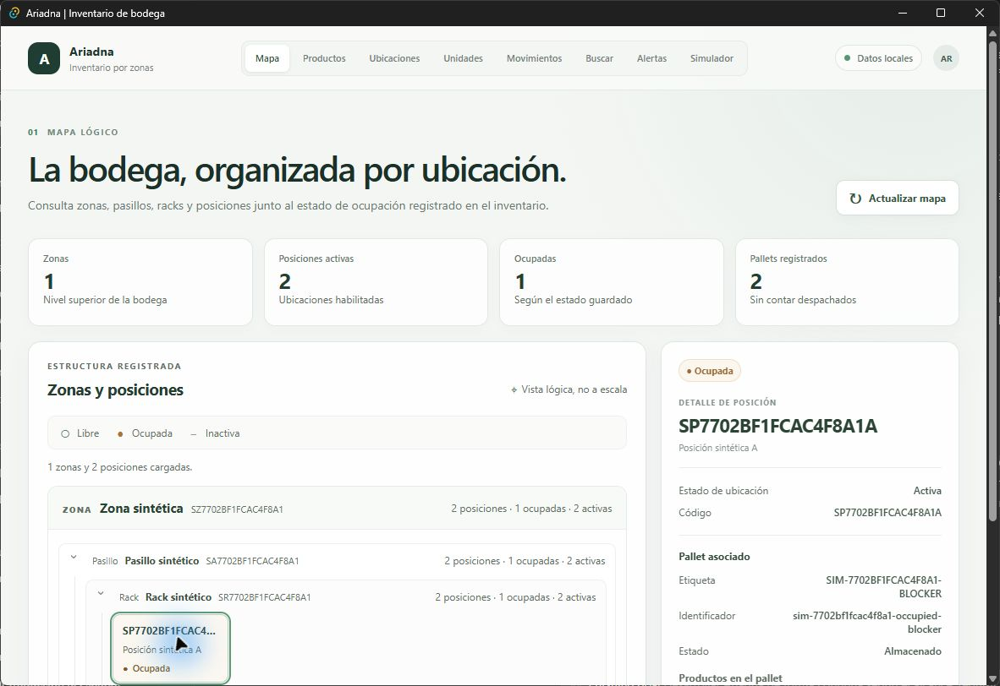
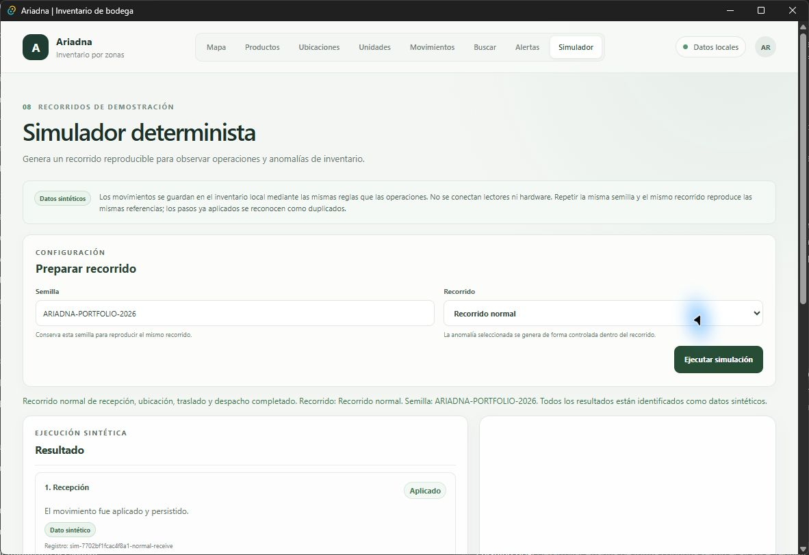
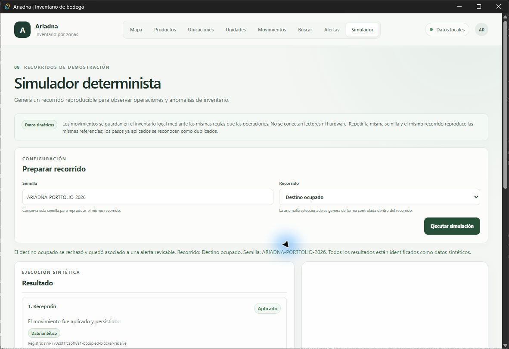

# Ariadna: guía de instalación y demostración

Ariadna es un prototipo local de escritorio para explorar inventario por ubicación e historial de movimientos en una bodega de demostración. Este documento permite ejecutar el código, recorrer sus funciones principales y entender qué evidencia ofrece el prototipo.

## Qué demuestra

La aplicación organiza ubicaciones como zona, pasillo, rack y posición. Permite mantener un catálogo de productos, registrar la recepción de pallets, asignarlos a posiciones, trasladarlos, despacharlos y consultar la cronología de movimientos. La búsqueda transversal y la bandeja de alertas ayudan a revisar el estado registrado y los intentos que requieren atención.

El repositorio incluye un simulador reproducible para recorrer operaciones normales y anomalías. Las operaciones simuladas usan los mismos casos de uso y la misma base SQLite local que las operaciones introducidas en la interfaz; el simulador no mantiene un inventario paralelo.

## Alcance y limitaciones

- Todos los ejemplos y capturas de esta guía usan datos sintéticos.
- No se conectan robots, sensores, lectores de código de barras, RFID ni otro hardware.
- El mapa lógico y la jerarquía de ubicaciones se configuran manualmente; no se escanea ni mapea automáticamente una bodega física.
- La aplicación sigue el inventario por pallet o unidad de manipulación y registra las líneas de productos asociadas. No rastrea cada artículo individual mediante sensores.
- La persistencia es local con SQLite. No hay sincronización remota, operación multiusuario, integración ERP/WMS, API de negocio, autenticación ni despliegue productivo.
- El instalador NSIS de demostración no está firmado con Authenticode. Windows puede mostrar advertencias de reputación y algunas políticas de seguridad pueden bloquearlo.
- Las pruebas automatizadas y la evidencia de CI no equivalen a un piloto en una bodega real ni a una garantía de operación productiva.

## Requisitos para ejecutar desde el código

La plataforma validada es Windows x64. Para desarrollar y compilar se necesita Rust estable con el target `x86_64-pc-windows-msvc`, Microsoft C++ Build Tools con la carga **Desktop development with C++** y Windows SDK, Node.js 24.x con npm, y WebView2. Consulta los [prerrequisitos oficiales de Tauri para Windows](https://v2.tauri.app/start/prerequisites/), [instalación de Rust](https://www.rust-lang.org/tools/install), [Node.js 24.22.1](https://nodejs.org/en/download/archive/v24.22.1), [Microsoft C++ Build Tools](https://visualstudio.microsoft.com/visual-cpp-build-tools/) y [descargas de WebView2 Runtime](https://developer.microsoft.com/en-us/microsoft-edge/webview2/).

El entorno registrado y verificado en este proyecto es Windows 11 Pro 25H2, Rust/Cargo 1.99.1 con `x86_64-pc-windows-msvc`, Visual Studio Community 2022 con herramientas C++ y Windows SDK 10.0.26100.0, Node.js 24.22.1, npm 11.19.1 y WebView2 Runtime 157.0.4341.42. Para ejecutar únicamente el instalador no hacen falta Rust, Node ni las herramientas C++; se requiere Windows x64 y que WebView2 Runtime esté disponible. Windows 10/11 normalmente ya lo incluyen, pero algunos equipos administrados o entornos LTSC pueden requerir instalarlo.

Desde PowerShell, clona el repositorio y ejecuta la aplicación:

```powershell
git clone https://github.com/shdez-dev/ariad.git
Set-Location ariad
npm ci
npm run tauri -- dev
```

Puedes comprobar las herramientas con `rustc --version`, `cargo --version`, `rustup show`, `node --version` y `npm --version`. El primer inicio crea la base local y las tablas requeridas. La base y los registros de Windows se guardan bajo `%APPDATA%\com.ariadna.inventory`. Para compilar solo la interfaz usa `npm run build`.

## Decisiones técnicas

- Rust contiene el dominio y los casos de uso para validar inventario y movimientos antes de persistirlos.
- Tauri v2 ofrece la ventana de escritorio y un puente IPC acotado hacia comandos Rust. La interfaz TypeScript no abre una API HTTP local.
- SQLx y SQLite guardan el catálogo, las ubicaciones, los pallets, sus líneas y el historial en el equipo. Las operaciones de inventario e historial se guardan en transacciones y las migraciones se mantienen versionadas.
- El frontend usa TypeScript, HTML y CSS empaquetados dentro de la aplicación. El simulador llama los casos de uso compartidos y permite demostrar resultados sin infraestructura o hardware.

Estas decisiones mantienen el prototipo ejecutable localmente y dejan visibles sus fronteras. Para más detalle consulta la [arquitectura base](../arquitectura-base.md), el [contrato IPC](../ipc-contract.md) y la [matriz de trazabilidad](../trazabilidad.md).

## Construir el instalador de Windows

Con las mismas herramientas de desarrollo instaladas, desde la raíz del repositorio ejecuta:

```powershell
npm ci
npm run tauri -- build
```

El instalador NSIS se genera en `src-tauri/target/release/bundle/nsis/`. En esta etapa no se configura firma de código; se espera que `Get-AuthenticodeSignature` indique `NotSigned`. La guía [`windows-installer.md`](../distribution/windows-installer.md) detalla el artefacto, la prueba de instalación en CI y sus limitaciones. Si Windows bloquea el binario por políticas de seguridad, utiliza un entorno de desarrollo permitido; no desactives controles del equipo.

## Recorrido sugerido de demostración

Usa nombres, códigos, SKU y cantidades inventados. El flujo representa una operación de ejemplo:

1. En **Productos**, selecciona **Nuevo producto** y crea un SKU sintético con nombre y unidad de medida.
2. En **Ubicaciones**, crea en orden una zona, un pasillo, un rack y una o más posiciones activas, eligiendo cada ubicación superior.
3. En **Movimientos**, usa **Recepción** para registrar el pallet con una etiqueta ficticia y una o más líneas del producto. La unidad queda pendiente de ubicación.
4. En **Movimientos**, abre **Asignar posición**, elige la unidad recibida y una posición activa libre. En **Mapa** revisa que la ocupación guardada muestre ese pallet.
5. En **Movimientos**, abre **Trasladar** y elige una unidad almacenada y otra posición activa libre. Confirma el traslado y en **Unidades** revisa el origen, destino, fecha y tipo de movimiento.
6. En **Buscar**, consulta el producto, pallet o ubicación. Abre el resultado del pallet para ver su ficha y la **Cronología de movimientos**.
7. En **Movimientos**, abre **Despachar** y confirma la salida. Comprueba que la posición queda libre y que el pallet conserva sus líneas e historial.
8. En **Simulador**, conserva una semilla, elige **Recorrido normal** y pulsa **Ejecutar simulación**. Luego prueba **Destino ocupado** o **Etiqueta desconocida** y abre la alerta relacionada desde **Alertas**.

El simulador usa identificadores y marcas de tiempo deterministas según la pareja de semilla y escenario seleccionada. Escenarios distintos mantienen catálogos sintéticos independientes aunque compartan una semilla. Al volver a ejecutar escenarios de anomalía puede añadir nuevos intentos y alertas al historial local. Para una demostración repetible, inicia con un perfil de datos limpio o conserva la semilla y el estado de la base que documentes.

## Capturas con datos sintéticos

Las capturas muestran el resultado de los escenarios del simulador y la ocupación registrada en el mapa. No representan una bodega ni una lectura de hardware real.







## Verificaciones y evidencia

El workflow de GitHub Actions ejecuta en Windows las pruebas frontend, el build de TypeScript, `cargo fmt --check`, Clippy, las pruebas Rust, las pruebas del benchmark y la generación/verificación del instalador. Para repetir las comprobaciones locales desde la raíz del repositorio:

```powershell
npm ci
npm run build
npm run test:map
npm run test:catalog
npm run test:simulator
npm run test:ipc
npm run test:accessibility
cargo fmt --manifest-path src-tauri/Cargo.toml -- --check
cargo test --manifest-path src-tauri/Cargo.toml
cargo clippy --manifest-path src-tauri/Cargo.toml --all-targets -- -D warnings
```

En la revisión base de la demostración, el commit [`8b99a96c7b945495caba3e292f20291d8171db09`](https://github.com/shdez-dev/ariad/commit/8b99a96c7b945495caba3e292f20291d8171db09) pasó el workflow [CI / Windows 43100633823](https://github.com/shdez-dev/ariad/actions/runs/43100633823), que publicó el artefacto NSIS `ariadna-windows-nsis-8b99a96c7b945495caba3e292f20291d8171db09`. Las capturas de esta guía se generaron sobre esa revisión con perfil aislado y datos sintéticos. Los artefactos de CI tienen retención temporal; verifica disponibilidad y hash en la ejecución antes de reutilizar el instalador.

La verificación local de los cambios de guía y compatibilidad de migraciones pasa `npm run build`, las cinco suites frontend (16 pruebas), `cargo fmt --check`, `cargo test` (76 pruebas) y `cargo clippy --all-targets -- -D warnings`. El primer commit, `f28c8a9`, tuvo un fallo de CI en `Test Rust` porque el runner Windows transformó los finales de línea de las migraciones; el commit correctivo fija LF y cubre los checksums CRLF históricos.

La revisión correctiva [`b0e4e4942670dd4e33db0b67128959d6b4eec827`](https://github.com/shdez-dev/ariad/commit/b0e4e4942670dd4e33db0b67128959d6b4eec827) pasó el [CI / Windows 43107801858](https://github.com/shdez-dev/ariad/actions/runs/43107801858), incluidas pruebas, bundle NSIS y ciclo de instalación/inicio/desinstalación. El artefacto `ariadna-windows-nsis-b0e4e4942670dd4e33db0b67128959d6b4eec827` (ID `13895132604`) contiene `Ariadna_0.1.0_x64-setup.exe` y el informe; el ZIP pesa 2.360.444 bytes y su SHA-256 es `d9098310074f1478d3dbb585dc700387a0291fdf2edfdc7cbf625e6c8d387d27`. La inspección manual confirmó el hash del ZIP, que el instalador mide 2.377.786 bytes y que su SHA-256 (`08A51E0320E0DF9D2DE969292EE02C3F51EE48E20DFBAA118090BC78FEE2C851`) coincide con el informe. `Get-AuthenticodeSignature` indica `NotSigned`. La instalación y desinstalación se verificaron en un runner limpio de CI; el artefacto no se ejecutó en el perfil local.

## Revisión de origen

Esta guía acompaña a Ariadna `0.1.0` en el repositorio [`shdez-dev/ariad`](https://github.com/shdez-dev/ariad). La revisión de origen y su workflow asociado se enlazan arriba para que se puedan verificar por separado las capturas y el instalador. Los incrementos posteriores se revisan en la rama publicada y su correspondiente ejecución de CI. El detalle de cambios y límites está en [`trazabilidad.md`](../trazabilidad.md), la [guía de operación y restauración](../operacion/copias-y-restauracion.md) y las notas de distribución.

Esta guía se actualizó en el commit [`dd2c0e9ec0cf90aa6304df6d7fbc94b396b3d30f`](https://github.com/shdez-dev/ariad/commit/dd2c0e9ec0cf90aa6304df6d7fbc94b396b3d30f). Su [CI / Windows 43109513936](https://github.com/shdez-dev/ariad/actions/runs/43109513936) terminó `success` y publicó el artefacto NSIS `ariadna-windows-nsis-dd2c0e9ec0cf90aa6304df6d7fbc94b396b3d30f` (ID `13896385694`, 2.360.585 bytes, digest SHA-256 `67f6244c89828bffee76d81e68dcc1f34afa7e73018f876c004f2bc25c2590ca`). Este commit solo modifica documentación; la verificación manual del instalador y su estado `NotSigned` corresponde al artefacto de código `b0e4e4942670dd4e33db0b67128959d6b4eec827` descrito arriba. El artefacto de `dd2c0e9` se generó correctamente, pero no se descargó ni se inspeccionó manualmente.
